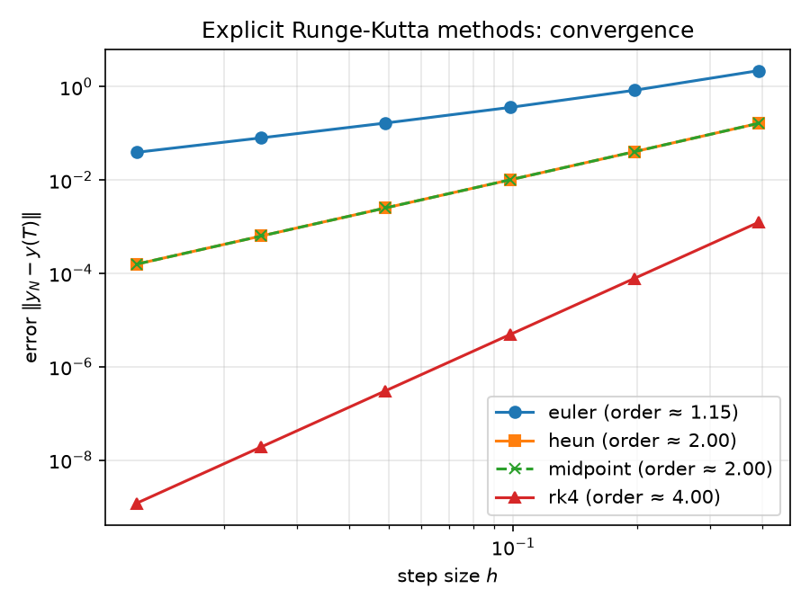
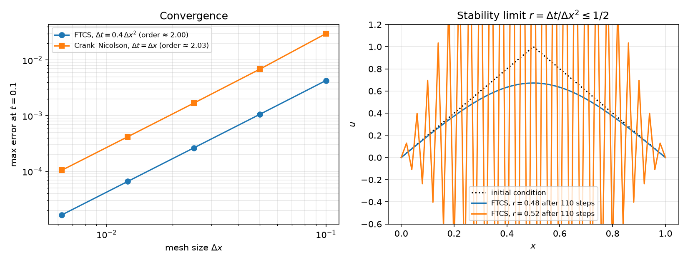
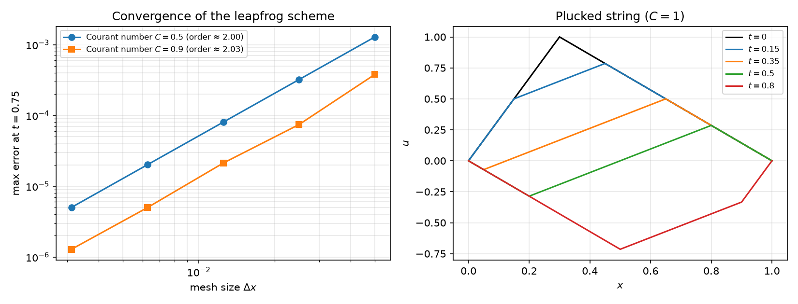
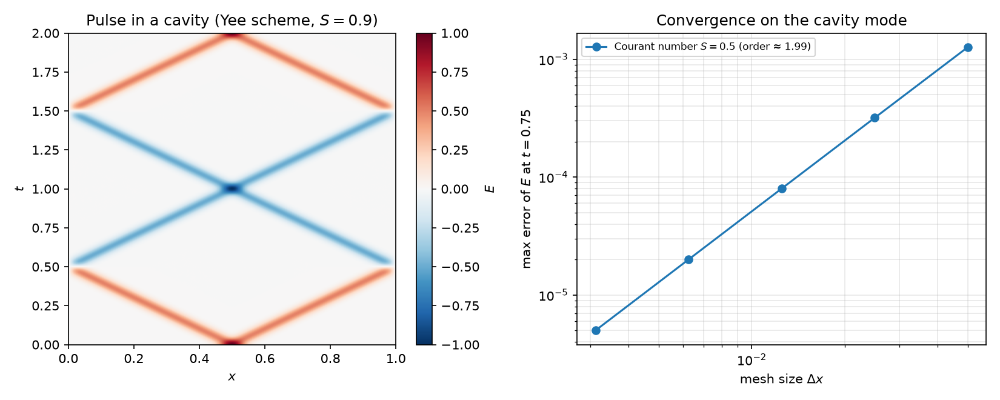

# Numerical Methods for ODEs and PDEs

Clean Python implementations of classical numerical methods for differential equations,
with convergence studies that check each method against its theoretical order.

## Explicit Runge–Kutta methods

For the initial value problem $y'(t) = f(t, y(t))$, $y(t_0) = y_0$, an $s$-stage explicit
Runge–Kutta method with step size $h$ computes

$$
k_i = f\Big(t_n + c_i h,\; y_n + h \sum_{j<i} a_{ij} k_j\Big), \qquad
y_{n+1} = y_n + h \sum_{i=1}^{s} b_i k_i ,
$$

where the coefficients are collected in the Butcher tableau $(A, b, c)$.
A method has order $p$ if the global error satisfies $\|y_N - y(T)\| = O(h^p)$.

The function `explicit_rk` accepts **any** explicit Butcher tableau; the following are built in:

| Method   | Stages | Order |
|----------|:------:|:-----:|
| Euler    | 1      | 1     |
| Heun     | 2      | 2     |
| Midpoint | 2      | 2     |
| Kutta 3  | 3      | 3     |
| RK4      | 4      | 4     |

### Convergence study

Test problem: the harmonic oscillator $x'' = -x$, $x(0)=1$, $x'(0)=0$, with exact solution
$x(t) = \cos t$, integrated over one period $[0, 2\pi]$.
The observed order is the slope of the error in a log–log plot:



Two remarks on the plot:

- **Heun and midpoint coincide.** For a linear problem $y' = \lambda y$ both methods give
  $y_{n+1} = \big(1 + h\lambda + \tfrac{(h\lambda)^2}{2}\big)\, y_n$, the degree-2 Taylor
  polynomial of $e^{h\lambda}$, so their errors are identical.
- **Euler's observed order is slightly above 1.** For the oscillator, explicit Euler multiplies
  the amplitude by $\sqrt{1+h^2}$ at every step, so the error is dominated by the amplitude drift
  $(1+h^2)^{N/2} - 1 \approx e^{hT/2} - 1$.
  For large $h$ this is not yet in the asymptotic regime $O(h)$; the slope tends to 1 as $h \to 0$.

## Heat equation: stability

$u_t = u_{xx}$ on $[0,1]$ with $u = 0$ at both ends, on a grid $x_i = i\,\Delta x$.
With $r = \Delta t / \Delta x^2$ and $\delta^2 u_i = u_{i+1} - 2u_i + u_{i-1}$:

| Scheme | Update | Accuracy | Stability |
|---|---|---|---|
| FTCS (explicit) | $u^{n+1} = u^n + r\,\delta^2 u^n$ | $O(\Delta t + \Delta x^2)$ | only if $r \le 1/2$ |
| Crank–Nicolson | $\big(I - \tfrac r2 \delta^2\big) u^{n+1} = \big(I + \tfrac r2 \delta^2\big) u^n$ | $O(\Delta t^2 + \Delta x^2)$ | always |

**Von Neumann analysis.** Inserting the Fourier mode $u_i^n = g^n e^{\mathrm{i} i\theta}$ into FTCS gives the
amplification factor $g(\theta) = 1 - 4r\sin^2(\theta/2)$. Then $|g| \le 1$ for every $\theta$ exactly when
$r \le 1/2$. For Crank–Nicolson,
$g(\theta) = \dfrac{1 - 2r\sin^2(\theta/2)}{1 + 2r\sin^2(\theta/2)}$, so $|g| \le 1$ for every $r$.
Each Crank–Nicolson step solves a tridiagonal system with the Thomas algorithm in $O(M)$ operations.



On the right, the initial condition is a "hat", which contains every Fourier mode.
Just above the limit ($r = 0.52$) the highest mode has $g(\pi) = 1 - 4r \approx -1.08$:
it changes sign and grows by 8% at every step, producing the saw-tooth that destroys the solution.
Just below the limit ($r = 0.48$) the same scheme gives the expected smooth decay.

## Wave equation: the CFL condition

$u_{tt} = c^2 u_{xx}$ is discretised with centred differences in time and space (leapfrog):

$$
u_i^{n+1} = 2u_i^n - u_i^{n-1} + C^2\, \delta^2 u_i^n, \qquad C = \frac{c\,\Delta t}{\Delta x}.
$$

The scheme is second order and stable under the **CFL condition** $C \le 1$: the numerical domain of
dependence must contain the physical one. For $C = 1$ the scheme becomes
$u_i^{n+1} + u_i^{n-1} = u_{i+1}^n + u_{i-1}^n$, which every d'Alembert solution $f(x - ct) + g(x + ct)$
satisfies exactly on the grid. So the plucked string on the right keeps its sharp corners.



## Maxwell's equations: the Yee scheme (FDTD)

In normalised units ($c = \varepsilon = \mu = 1$), a plane wave with fields $E = E_z(x,t)$ and
$H = H_y(x,t)$ satisfies

$$
\partial_t E = \partial_x H, \qquad \partial_t H = \partial_x E .
$$

The Yee scheme places $E$ on the nodes $x_i$ at integer times and $H$ on the midpoints $x_{i+1/2}$ at
half-integer times:

$$
E_i^{n+1} = E_i^n + S\big(H_{i+1/2}^{n+1/2} - H_{i-1/2}^{n+1/2}\big), \qquad
H_{i+1/2}^{n+3/2} = H_{i+1/2}^{n+1/2} + S\big(E_{i+1}^{n+1} - E_i^{n+1}\big),
$$

with $S = \Delta t / \Delta x \le 1$. Every difference is centred, so the scheme is second order.

**Why the staggering is natural.** The two fields live on two mutually *dual* grids, and the difference
$E_{i+1} - E_i$ is the exact integral of $\partial_x E$ over a cell (the fundamental theorem of calculus,
i.e. Stokes' theorem in one dimension). This is the simplest case of *discrete exterior calculus*:
the discrete counterpart of the formulation of electromagnetism with differential forms and
vector bundles studied in my Master's thesis.



On the left, a Gaussian pulse starts at rest, splits into two halves travelling at speed $c = 1$, and
changes sign at every reflection, because a perfect conductor forces $E = 0$ on the wall.
On the right, the error against the exact cavity mode $E = \sin(\pi x)\cos(\pi t)$ decreases like $\Delta x^2$.

## Project structure

```
numerical_methods/
    ode.py       explicit Runge–Kutta methods, order estimation
    heat.py      heat equation: FTCS, Crank–Nicolson, Thomas algorithm
    wave.py      wave equation: leapfrog
    maxwell.py   Maxwell's equations in 1D: Yee scheme
examples/        convergence studies that produce the figures
tests/           automatic checks against exact solutions
figures/         generated plots
```

## Usage

```python
import numpy as np
from numerical_methods import solve

# y' = -2 t y,  y(0) = 1   (exact: y = exp(-t^2))
t, y = solve(lambda t, y: -2 * t * y, (0, 2), 1.0, n_steps=100, method="rk4")
```

## Getting started

```bash
pip install -r requirements.txt
python -m examples.convergence_rk   # Runge–Kutta convergence study
python -m examples.heat_equation    # heat equation
python -m examples.wave_equation    # wave equation
python -m examples.maxwell_yee      # Maxwell's equations
pytest                              # runs the tests
```

## Roadmap

- [x] Explicit Runge–Kutta methods with convergence study
- [x] Finite differences for the heat equation (von Neumann stability)
- [x] Wave equation (CFL condition)
- [x] Maxwell's equations with the Yee scheme (FDTD)
- [ ] Adaptive step size (embedded Runge–Kutta pairs)
- [ ] Implicit methods and stiff problems
- [ ] Maxwell's equations in 2D

## Author

Danilo Colosimo — M.Sc. in Mathematics (University of Calabria & JMU Würzburg)
